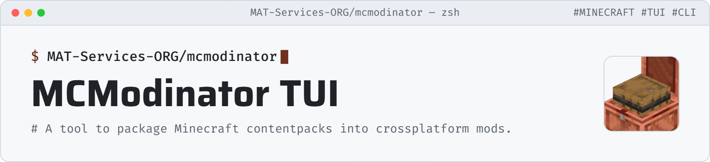

<picture>
  <source media="(prefers-color-scheme: dark)" srcset="art/header-dark.png">
  
</picture>

# Description
The Modinator is a tool created to create Minecraft Mods using [data](https://datapack.wiki/) and [ressource](https://minecraft.wiki/w/Resource_pack) packs, alied with [KubeLoader](https://github.com/WhiseNT/kubeloader) technologies.
It's a CLI tool that uses common mods architectures to create "universal" mods.
The original project was developed and archived by Tornato, at the name of [DatapackModinator](https://github.com/T0RNATO/datapackmodinator), originally writen in Python. This project is actually written in Rust and are in actual development on some new features, improvements and compatibility avancements.

# Configure
> For informations about the compatibility mode, check the [DatapackModinator](https://github.com/T0RNATO/datapackmodinator) project.

On the new version, configuring the mod is directly via the pack.mcmeta file: 
> [!IMPORTANT]
> Comments aren't supported, remove them before running the modinator. <br>
> Check [pack.mcmeta](https://github.com/MAT-Services-ORG/mcmodinator/blob/main/pack.mcmeta) for the non-commented template.
```json
{
	"pack": {
		"description": "My custom pack",
		"pack_format": 121, // Optional
		"supported_formats": {
			"min_inclusive": 4,
			"max_inclusive": 121
		}
	},
	"modinator": {
		"id": "mymod", // Will also be the name of the output file, depending of the CLI Arguments.
		"display_name": "My Mod",
		"mod_version": "1.0.0",
		"authors": ["Myself"],
		"license": "MIT",
		"forge_version": "[1,)", // https://maven.apache.org/enforcer/enforcer-rules/versionRanges.html are supported as strings for "forge_version" and "neoforge_version". You can also use integers when exact versions.
		"neoforge_version": "[1,)" 
	},
	"paths": { // Values can be set to None for none.
		"icon": "./icon.png",
		"assets": "./assets/",
		"data": "./data/",
		"kubeloader": { // // Require KubeLoader
			"server-js": "./server_scripts/",
			"client-js": "./client_scripts/",
			"startup-js": "./startup_scripts/"
		}
	},
	"dependencies": { 
		"examplemod": { // The identifier of the mod added as a dependency. Forge equivalent: Key modId.
			"forge": { // https://docs.minecraftforge.net/en/latest/gettingstarted/modfiles/ for more informations.
				"type": "required", // "required", "", ""
				"versionRange": "", // Optional The acceptable version range of the language loader, expressed as a Maven Version Range. An empty string matches any version. ("" if none)
				"ordering": "NONE", // Optional Defines if the mod must load before ("BEFORE") or after ("AFTER") this dependency. If the ordering does not matter, return "NONE"
				"side": "BOTH" // "BOTH", "CLIENT", "SERVER"
			},
			"fabric": "*" // Version Range only. Optional. https://docs.fabricmc.net/develop/loader/fabric-mod-json#dependency-resolution
		}
	}
}
``` 
# Using command line
(For those who aren't familiar with command line, considere using the complementary TUIs files to have a minimal UI.)
```
Usage: modinator [OPTIONS]

Options:
  -l, --legacy-parser  Uses legacy parsing system (Check https://github.com/T0RNATO/datapackmodinator/ for informations)
  -d, --doc [<TOPIC>]  Print documentation
  -h, --help           Print help
  -V, --version        Print version

Project Options:
  -p, --project-path <FOLDER>  Define project path [default: .]
  -o, --output-path <FOLDER>   Define output folder [default: .]

Build Options:
  -m, --mod-build <BOOL or FILENAME>    Set Mod output [default: <ID>-mod.jar]
  -c, --cpack-build <BOOL or FILENAME>  Set ContentPack output [default: False (Set to "<ID>-CPack.jar" if True.)]
```
## Options:
### Legacy parser `--legacy-parser`
The Legacy Parser is a parser to compatibilize project created using [DatapackModinator](https://github.com/T0RNATO/datapackmodinator) wigout needing to change anything. It is possible than it does not include all the functionnalities and latest improvements. Considere updating to the new parsing system when possible.

### Doccumentation `--doc`
Shows the informations needed in the terminal. Can be helpful for offline mode. 
<br>To access a specific topic in the doccumentation, type `modinator -d <TOPIC>`. 
<br>The list of topics is aviable by writing `modinator -d LIST`.

### Help `--help`
Just show the help like up.

### Version `--version`
Just shows the version you're in.

## Project Options:
### Path of the Project `--project-path`
Just define the path of the project to work on. 
Considered as the current working directory if none is set.

### Path for outputs `--output-path`
Just define where to create the files.
Considered as the current working directory if none is set.

## Build Options
All the options here define what you will or will build and the filenames via a String or Bolean values.
